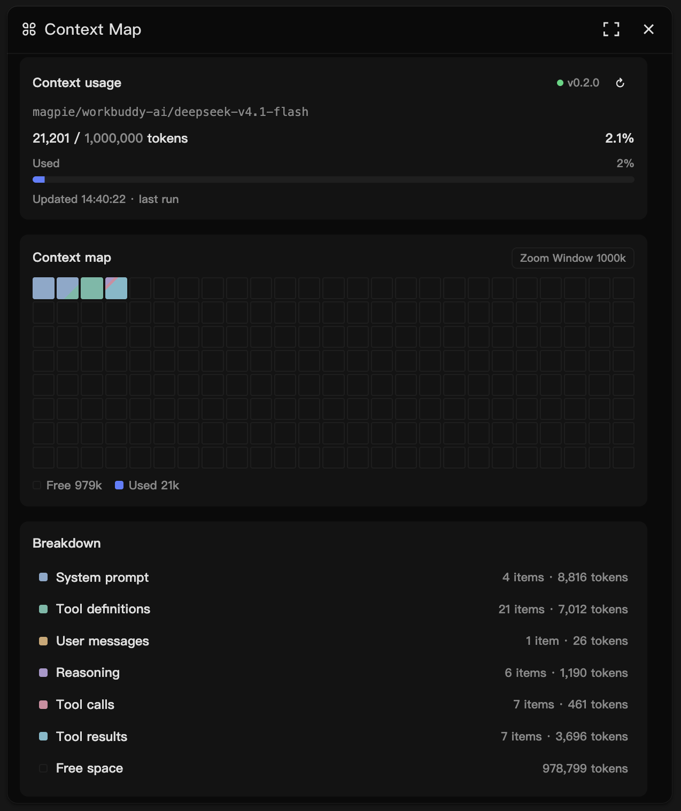
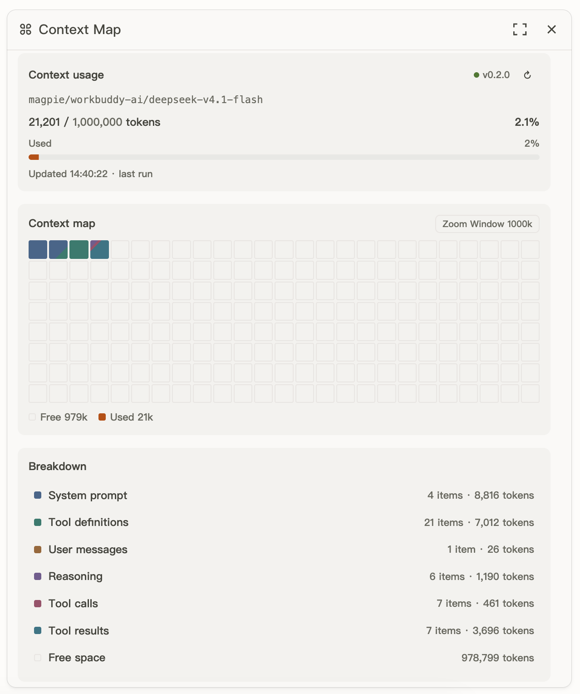

# Context Map

[](https://github.com/mel0nyrame/openchamber-context-map/actions/workflows/ci.yml)
[](LICENSE)

[中文](README.zh.md)

See what fills your context window.

Context Map is an OpenChamber rail panel that shows where the current session's last model request spent its context. It breaks the request into system prompt, tool definitions, user messages, reasoning, tool calls, and tool results, then shows the free space that remains.

<p align="center">
  
  
</p>

<p align="center"><sub>Dark and light themes. The panel follows OpenChamber's theme.</sub></p>

## Features

- **Context usage**: model, `used / window`, percentage, and badges for estimated numbers, an assumed window, or a baseline snapshot.
- **Context map**: 200 cells, each 1/200 of the denominator. Used cells are colored by category; free space is outlined.
- **Breakdown**: one row per non-empty category plus Free space. Open a row to list its items, then open an item to read its preview.

## Requirements

**To install**

- macOS or Linux. Only macOS has been verified; Windows is untested.
- OpenChamber 2.7.0 or newer for the one-click install. The manual install is verified on OpenChamber 2.5.2.
- OpenCode 2.2.2 or newer with the V2 plugin API. OpenChamber 2.7.0 bundles OpenCode 2.2.6.

**To develop**

- [Bun](https://bun.sh/) 1.3 or newer.

## Install

### From OpenChamber (recommended)

1. Open **Settings → Extensions**.
2. Paste the repository URL into **Folder, ZIP, or URL**:

   ```text
   https://github.com/mel0nyrame/openchamber-context-map.git
   ```

3. Click **Add**.
4. Approve the permissions OpenChamber asks for. The extension needs the **Service** capability and permission to run its **OpenCode plugin**.
5. Open **Context Map** from the rail.

This path needs OpenChamber 2.7.0 or newer. The extension includes the Collector, so there is no separate install step. OpenChamber loads the extension and its OpenCode plugin automatically. If the panel does not appear, restart OpenChamber once; if it still says `Collector is not running`, restart OpenCode.

<details>
<summary>Manual install (development or older OpenChamber)</summary>

The manual install is verified on OpenChamber 2.5.2 and OpenCode 2.2.2. It needs [Bun](https://bun.sh/) 1.3 or newer and a stable repository path. It creates a symlink, copies the Collector into the OpenCode plugin directory, and registers the extension in `extensions.json`.

```bash
git clone <repository-url> openchamber-context-map
cd openchamber-context-map
bun run install
```

The installer needs no `node_modules` and does not build anything. It performs three steps:

1. Creates the symlink `~/.config/openchamber/extensions/context-map` pointing at the repository root.
2. Copies `collector/main.js` to `~/.config/opencode/plugins/context-map.js` with a version marker on the first line.
3. Registers the extension path in `~/.config/openchamber/extensions.json` and grants the `service` capability.

After installing, **fully quit** OpenCode and OpenChamber, then reopen them:

- OpenCode must exit completely. Closing the window is not enough; the Collector only loads at process start.
- Open the **Context Map** panel from the rail in OpenChamber.
- The status dot next to the title is green and shows the installed version, for example `v0.2.0`; hovering it reads `Collector connected · v0.2.0`. If it says `Collector is not running`, confirm that OpenCode was actually restarted.

Default paths:

| Item | Path |
| --- | --- |
| Extension symlink | `~/.config/openchamber/extensions/context-map` → repository root |
| Collector | `~/.config/opencode/plugins/context-map.js` |
| Extension registry | `~/.config/openchamber/extensions.json` |

Override non-default directories with environment variables:

```bash
OPENCHAMBER_DATA_DIR=/path/to/openchamber bun run install
XDG_CONFIG_HOME=/path/to/config bun run install
```

The installer is idempotent: running it again does not create a second symlink, a second Collector file, or duplicate registry entries. It only accepts an empty target, a symlink pointing at this repository, or a Collector file carrying the `@context-map-collector` marker. If a target already exists and was not created by this tool, the installer stops and leaves the file untouched.

Quit OpenChamber before installing or uninstalling. A running host may rewrite `extensions.json` at the same time, and the change requires a restart anyway.

#### If the installer refuses to continue

When it reports that the extension or Collector target already exists, it has not overwritten anything. Inspect the target:

```bash
ls -ld ~/.config/openchamber/extensions/context-map
ls -l ~/.config/opencode/plugins/context-map.js
```

If it is an old file of yours, back it up and move it away, then run `bun run install` again. Do not delete a directory whose origin you are unsure of.

</details>

## Use

### Context usage

The card shows the model name, `used / window`, the percentage, and badges for estimated numbers, an assumed window, or a baseline snapshot. The status dot and version sit next to the title. The refresh button reloads the snapshot.

### Context map

200 cells, each representing 1/200 of the denominator. Used cells are colored by category; the remaining cells are outlined to show free space. Press `Z` or click the Zoom label to switch between `Window` and `Fit`. `Window` uses the model's context window. `Fit` uses `min(window, ceil2sig(used × 1.15))`, with a 10k floor.

### Breakdown

One row per non-empty category plus Free space. Click a row to list its items; click an item to read its preview. `Esc` goes back one level, `↑`/`↓` or `j`/`k` moves, and `Enter` opens the focused row.

### Baseline

Before a session's first request, the panel shows a baseline built from the most recent real request for the same agent and model: system prompt and tool definitions only. It is marked `baseline` and `estimated`, and the first real request replaces it. If no such request exists yet, the panel waits for the first request instead.

### Restore and persistence

The Collector saves each snapshot's summary to disk, so the panel still shows the last context after OpenCode restarts. Restored snapshots are marked `last run`. Only the summary and item heads are kept; item previews are not, so opening an item from a restored snapshot says the preview is unavailable until a new request arrives.

### Language

The panel follows OpenChamber's language. English is the source language; Chinese is translated; any other locale falls back to English.

## How it works

Context Map has two parts:

- **OpenChamber extension**: the panel and a host-side Service.
- **OpenCode Collector**: an in-process OpenCode plugin that records the assembled system prompt, tools, and messages just before a request goes to the provider.

The panel keeps only the last request per session. Snapshots live in memory, and the Collector also persists a summary of each one, so the panel can restore the last context after OpenCode restarts; item previews are not persisted. Tokens are estimated from character counts and calibrated against the most recent assistant's `input + cache.read + cache.write`. See [`docs/adr/0003-token-accounting.md`](docs/adr/0003-token-accounting.md).

## Upgrade

### From OpenChamber

Open **Settings → Extensions** and update Context Map when a new version is available. If the card does not offer an update, remove the extension and add it again from the same URL. The extension and its bundled Collector update together.

If the panel says the Collector is outdated after an update, fully quit every OpenCode instance and reopen it. The panel only warns; it never updates the Collector automatically (see [`docs/adr/0008-degradation-layers.md`](docs/adr/0008-degradation-layers.md)).

<details>
<summary>Manual upgrade steps</summary>

The extension directory is a symlink, so OpenChamber picks up repository changes on reload. The Collector is a copy in the OpenCode plugin directory and only updates when the installer runs again. Upgrade both together:

```bash
cd openchamber-context-map
git pull
bun run install
```

Then fully quit and reopen OpenCode and OpenChamber. Installer output such as `Updated: ... (old -> new)` or `Build artifacts updated` means the Collector was replaced.

#### The panel says the Collector is outdated

The running Collector version does not match the version the extension expects. The panel only warns; it never updates the Collector automatically (see `docs/adr/0008-degradation-layers.md`).

1. Run `bun run install` in the repository and confirm that the Collector was updated to the expected version.
2. Fully quit **every** OpenCode instance, then reopen. Closing one window or restarting one instance can leave an old process registered.
3. The status should return to `Collector connected · vX.Y.Z`, and the warning should disappear.

If the warning persists, check:

```bash
head -1 ~/.config/opencode/plugins/context-map.js
```

The first line should be `// @context-map-collector v<version>`. If the file is current but the panel still warns, an old OpenCode process is usually still running; quit all instances and retry. `pgrep -fl opencode` lists leftovers.

</details>

## Uninstall

### From OpenChamber

Open **Settings → Extensions**, find Context Map, and remove it. This removes the extension and its bundled Collector. Restart OpenChamber if the rail still shows the panel.

<details>
<summary>Manual uninstall steps</summary>

```bash
cd openchamber-context-map
bun run uninstall
```

Uninstall removes only:

- the `~/.config/openchamber/extensions/context-map` symlink pointing at this repository;
- `~/.config/opencode/plugins/context-map.js` when it carries the `@context-map-collector` marker;
- the matching path in `extensions.json`, plus grants and storage ids left behind when no other installation of the same guest remains.

Other extensions, your own plugins, and unknown registry fields are preserved. Restart OpenCode and OpenChamber afterwards. If a target was not created by this tool, the script keeps it and exits non-zero; inspect it before removing anything by hand.

</details>

## Troubleshooting

### Collector is not running

The panel shows `Collector is not running` and mentions a missing discovery file.

If you installed from OpenChamber:

1. Open **Settings → Extensions** and confirm that Context Map is enabled and its OpenCode plugin permission is granted. If either is missing, enable the extension or grant the permission.
2. Confirm OpenCode is running and the discovery directory has a file for the current process:

   ```bash
   ls -l ~/.local/state/openchamber-context-map/collectors/
   ```

   You should see `collector-<pid>.json`. If `CONTEXT_MAP_DISCOVERY_DIR` is set, look there instead.

3. If the file is missing, update or reinstall the extension, then restart OpenCode. An old OpenCode version, a plugin load error, or closing only the window can all prevent the Collector from loading.

If you used the manual install, also confirm the plugin file exists:

```bash
ls -l ~/.config/opencode/plugins/context-map.js
```

If it is missing, run `bun run install` again, then fully quit and reopen OpenCode.

`opencode plugin list` only lists plugins installed as packages. When you use the manual install, it does not list local files in `~/.config/opencode/plugins/`; `No plugins found` there does not mean the Collector is missing.

If the discovery file exists but the panel says `Collector is not responding`, a stale discovery file from an old process is the usual cause. Quit OpenCode, delete `collector-*.json` in that directory, and reopen OpenCode.

### Service is not ready

The panel shows `Service is not ready`, or the host returns `NO_SERVICE` / `NOT_GRANTED`.

1. Open **Settings → Extensions** and confirm that Context Map is enabled with the Service capability granted. If it is missing, reinstall the extension from the same URL.
2. If you used the manual install, run `bun run install` again; it registers the extension and grants `service` if the registry entry is missing it.
3. Fully quit and reopen OpenChamber.

If the panel shows `Service stopped` (`SERVICE_FAILED`), restart OpenChamber first. If it still fails, check for multiple OpenChamber instances or look for Service startup errors in the OpenChamber log.

### No snapshot yet

The status is connected, but the panel waits for the first request. The current session has no recorded request yet:

- Send a message in the session; the snapshot appears after the request completes.
- Only the last request is kept; switching sessions shows each session's own last request.
- Restarting OpenCode clears memory; restored summaries come back from disk, but a new session stays empty until its first request.
- The panel stops polling while idle. If a request just finished and nothing changed, click refresh in the usage card.

### Port conflicts

OpenChamber assigns the Service port through `OPENCHAMBER_SERVICE_PORT`; the Collector uses a random loopback port. Neither needs manual configuration.

- `EADDRINUSE` in the OpenChamber log usually means a duplicate OpenChamber instance or a port taken by another process. Quit all instances and start one.
- Collector port conflicts are rare. If the port in a discovery file is taken, the Service fails its probe and tries the next Collector. Quit OpenCode, clean stale discovery files, and reopen.
- With several OpenCode instances, the Service asks them from newest to oldest `startedAt` and returns the first valid snapshot (see `docs/adr/0009-collector-routing.md`). If the panel shows another instance's data, close the unused instance.

### The panel is missing from the rail

1. Open **Settings → Extensions** and confirm that Context Map is not disabled. Enable it if it is.
2. If you used the manual install, check that `paths` in `~/.config/openchamber/extensions.json` contains `.../extensions/context-map`; rerun `bun run install` if it does not.
3. Fully quit and reopen OpenChamber. A running host does not notice external registry changes.

## Development

```bash
bun install
bun run build
bun run dev
```

The terminal prints a preview URL such as `http://127.0.0.1:xxxxx`. `bun run dev` starts with an empty panel; click **Simulate request** in the page to inject a snapshot.

`bun install` runs the `install` script from `package.json` as a lifecycle step; the installer detects that invocation and skips installing the extension. Use `bun run install` for the extension itself.

To skip the manual click, start with a fixed snapshot:

```bash
bun run dev:fixture
```

It injects `DEV_FIXTURE` at startup, so the full panel appears without a real OpenCode request. The dev harness starts an in-process Collector, a Service child process, and a fake host; discovery uses a temporary directory and is cleaned up on exit. No installed extension is needed.

The dev bar switches Session A/B, busy/idle, lifecycle events, and simulated Service or Collector failures (`NO_SERVICE`, `NOT_GRANTED`, `DISABLED`, a stuck Collector, an outdated Collector). Add `?locale=en` or `?locale=zh` to preview either language and `?theme=dark` for the dark palette.

Before committing:

```bash
bun test
bun run typecheck
bun run check:docs
```

`bun run check:docs` fails when a file under `src/` or `scripts/` has no row in `docs/modules.md`, so adding or deleting a module means updating that table.

Manual acceptance steps that need a real OpenCode and OpenChamber are in `docs/manual-checklist.md`.

### Why build artifacts are committed

`panel/main.js`, `service/main.js`, and `collector/main.js` are committed build outputs. OpenChamber reads the manifest and entry files without running a build, so an extension installed without them would not load. After changing `src/`, run:

```bash
bun run build
```

and commit all three outputs. Do not edit generated files by hand; the build script is `scripts/build.ts`, and the rationale is in `docs/adr/0004-build-artifacts-committed.md`.

## Layout

```text
src/collector/   OpenCode Collector
src/service/     OpenChamber host Service
src/panel/       Panel
src/shared/      Protocol, discovery, version
scripts/         install, dev, build, docs check
tests/           Unit tests, named after the module they cover
panel/           Panel build output
service/         Service build output
collector/       Collector build output
prototype/       Throwaway UI prototypes (prototype/README.md)
docs/modules.md  Every source file with its exports and job
docs/adr/        Architecture decision records, indexed by docs/adr/README.md
docs/assets/     README screenshots
```

## Privacy

Context Map itself makes no external network requests; the Collector and Service communicate over loopback only.

- Each session keeps only its last request, up to 20 sessions.
- The Collector saves each snapshot's summary to `~/.local/state/openchamber-context-map/snapshots`: item heads (200 characters), token counts, and the model name. Item previews are not saved. Files are mode 0600 in a 0700 directory and expire after 7 days.
- Set `CONTEXT_MAP_PERSIST=0` to keep snapshots in memory only.
- A preview is truncated to 8000 characters, in memory only.
- Discovery files are mode 0600 and their directory is 0700. The bearer token is used only between the Collector and the Service and never reaches the panel.

## License

MIT. See `LICENSE`.
