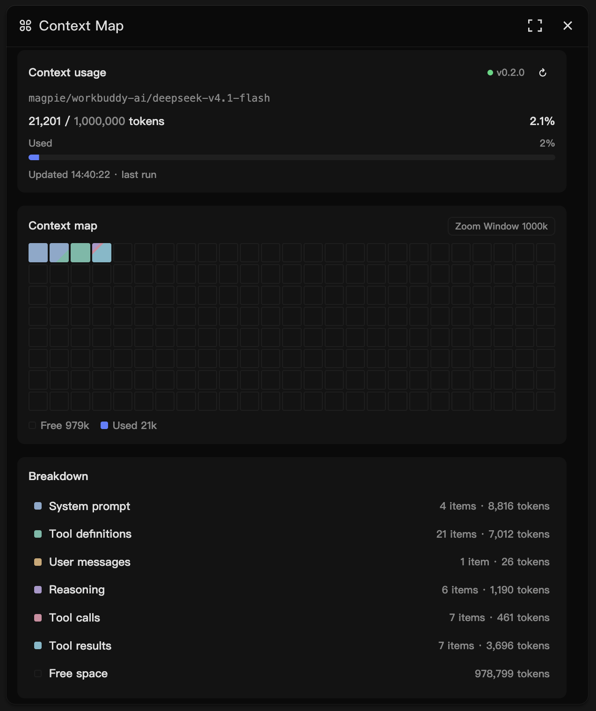
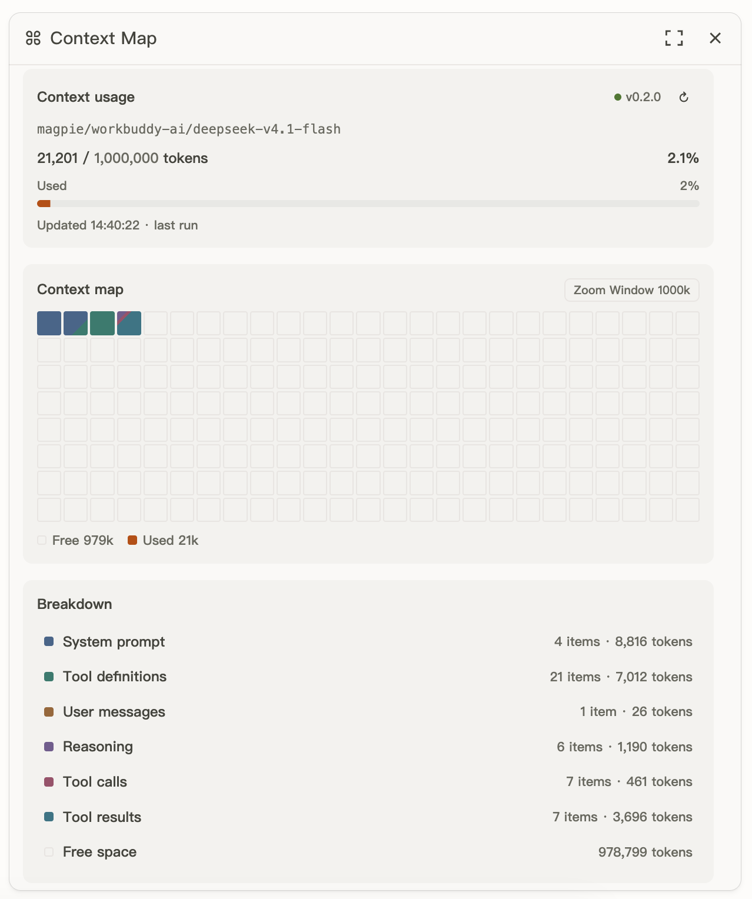

# Context Map

[](https://github.com/mel0nyrame/openchamber-context-map/actions/workflows/ci.yml)
[](LICENSE)

[English](README.md)

看清上下文窗口被什么占满。

Context Map 是 OpenChamber 右侧 rail 上的一个面板，展示当前 session 最后一次模型请求的上下文都用在了哪里。它把请求拆成 system prompt、工具定义、用户消息、推理、工具调用和工具结果，并显示剩余空间。

<p align="center">
  
  
</p>

<p align="center"><sub>深色与浅色主题。面板跟随 OpenChamber 的主题。</sub></p>

## 功能

- **上下文用量**：模型名、`used / window`、百分比，以及估算数字、假定窗口或基线快照的标记。
- **Context map**：200 个格子，每格代表分母的 1/200。已用格子按分类着色；空闲空间用描边表示。
- **Breakdown**：每个非空分类一行，外加一行 Free space。点击一行列出其中的条目；点击条目查看预览。

## 环境要求

**安装**

- macOS 或 Linux。仅验证过 macOS；Windows 未测试。
- 一键安装需要 OpenChamber 2.7.0 或更高版本。手动安装已在 OpenChamber 2.5.2 上验证。
- OpenCode 2.2.2 或更高版本，支持 V2 插件 API。OpenChamber 2.7.0 内置 OpenCode 2.2.6。

**开发**

- [Bun](https://bun.sh/) 1.3 或更高版本。

## 安装

### 从 OpenChamber 安装（推荐）

1. 打开 **Settings → Extensions**。
2. 在 **Folder, ZIP, or URL** 中粘贴仓库地址：

   ```text
   https://github.com/mel0nyrame/openchamber-context-map.git
   ```

3. 点击 **Add**。
4. 批准 OpenChamber 请求的权限。扩展需要 **Service** 能力和运行其 **OpenCode 插件**的权限。
5. 从 rail 打开 **Context Map**。

一键安装需要 OpenChamber 2.7.0 或更高版本。扩展已包含 Collector，不需要单独安装。OpenChamber 会自动加载扩展及其 OpenCode 插件。如果面板没有出现，重启一次 OpenChamber；如果仍显示 `Collector 未运行`，重启 OpenCode。

<details>
<summary>手动安装（开发或旧版 OpenChamber）</summary>

手动安装已在 OpenChamber 2.5.2 和 OpenCode 2.2.2 上验证。它需要 [Bun](https://bun.sh/) 1.3 或更高版本，以及稳定的仓库路径。它会创建软链、把 Collector 复制到 OpenCode 插件目录，并在 `extensions.json` 中登记扩展。

```bash
git clone https://github.com/mel0nyrame/openchamber-context-map.git
cd openchamber-context-map
bun run install
```

安装脚本不需要 `node_modules`，也不执行构建。它做三件事：

1. 创建软链 `~/.config/openchamber/extensions/context-map`，指向仓库根目录。
2. 把 `collector/main.js` 复制到 `~/.config/opencode/plugins/context-map.js`，并在首行写入版本标记。
3. 在 `~/.config/openchamber/extensions.json` 中登记扩展路径，并授予 `service` 能力。

安装后**完全退出** OpenCode 与 OpenChamber，再重新打开：

- OpenCode 必须完全退出，只关闭窗口不够。Collector 只在进程启动时加载。
- 在 OpenChamber 的 rail 中打开 **Context Map** 面板。
- 标题旁的状态圆点为绿色并显示已安装的版本，例如 `v0.2.0`；悬停时显示 `Collector 已连接 · v0.2.0`。如果显示 `Collector 未运行`，确认 OpenCode 确实重启过。

默认路径：

| 项目 | 路径 |
| --- | --- |
| 扩展软链 | `~/.config/openchamber/extensions/context-map` → 仓库根目录 |
| Collector | `~/.config/opencode/plugins/context-map.js` |
| 扩展注册表 | `~/.config/openchamber/extensions.json` |

用环境变量覆盖非默认目录：

```bash
OPENCHAMBER_DATA_DIR=/path/to/openchamber bun run install
XDG_CONFIG_HOME=/path/to/config bun run install
```

安装脚本是幂等的：再次运行不会创建第二个软链、第二个 Collector 文件，也不会写入重复的注册表条目。它只接受空目标、指向本仓库的软链，或带 `@context-map-collector` 标记的 Collector 文件。如果目标已存在且不是本工具创建的，安装脚本会停止，并保留原文件不动。

安装或卸载前先退出 OpenChamber。运行中的 host 可能同时改写 `extensions.json`，而且改动本来就需要重启才能生效。

#### 安装脚本拒绝继续

如果它报告扩展或 Collector 目标已存在，说明没有覆盖任何内容。检查目标：

```bash
ls -ld ~/.config/openchamber/extensions/context-map
ls -l ~/.config/opencode/plugins/context-map.js
```

如果是你以前留下的文件，先备份并移走，再运行 `bun run install`。不要删除来源不明的目录。

</details>

## 使用

### 上下文用量

卡片显示模型名、`used / window`、百分比，以及估算数字、假定窗口或基线快照的标记。状态圆点和版本位于标题旁。刷新按钮会重新读取快照。

### Context map

200 个格子，每格代表分母的 1/200。已用格子按分类着色；剩余格子用描边表示空闲空间。按 `Z` 或点击 Zoom 标签在 `Window` 与 `Fit` 之间切换。`Window` 使用模型的上下文窗口。`Fit` 使用 `min(window, ceil2sig(used × 1.15))`，下限为 10k。

### Breakdown

每个非空分类一行，外加一行 Free space。点击一行列出其中的条目；点击条目查看预览。`Esc` 返回上一级，`↑`/`↓` 或 `j`/`k` 移动，`Enter` 打开当前聚焦的行。

### 基线

session 的第一次请求之前，面板会显示一份**基线**，取自同一 agent 与 model 最近一次真实请求，只含 system prompt 与工具定义。它标记为「基线」与「估算」，第一次真实请求会替换它。如果还没有这样的请求，面板会等待第一次请求。

### 恢复与持久化

Collector 会把每份快照的摘要保存到磁盘，因此 OpenCode 重启后，面板仍会显示上次的上下文。恢复的快照标记为「上次运行」。只保留摘要和条目的 `head`；条目的预览不保留，所以从恢复的快照打开条目时，会提示预览不可用，直到有新请求到达。

### 语言

面板跟随 OpenChamber 的语言。英文是源语言；中文是翻译；其它 locale 回退到英文。

## 工作原理

Context Map 由两部分组成：

- **OpenChamber 扩展**：面板和 host 侧 Service。
- **OpenCode Collector**：运行在 OpenCode 进程内的插件，在请求发往 provider 前记录组装好的 system prompt、工具和消息。

面板只为每个 session 保留最后一次请求。快照保存在内存中，Collector 还会把每份快照的摘要持久化，因此 OpenCode 重启后面板仍能恢复上次的上下文；条目的预览不会持久化。Token 数按字符数估算，并用最近一条 assistant 消息的 `input + cache.read + cache.write` 校准。见 [`docs/adr/0003-token-accounting.zh.md`](docs/adr/0003-token-accounting.zh.md)。

## 升级

### 从 OpenChamber 升级

有新版本时，打开 **Settings → Extensions** 更新 Context Map。如果卡片没有更新按钮，移除扩展，再用同一个地址重新添加。扩展和随扩展安装的 Collector 会一起更新。

如果更新后面板提示 Collector 版本过旧，完全退出每一个 OpenCode 实例，再重新打开。面板只提示，不会自动更新 Collector（见 [`docs/adr/0008-degradation-layers.zh.md`](docs/adr/0008-degradation-layers.zh.md)）。

<details>
<summary>手动升级步骤</summary>

扩展目录是软链，OpenChamber 重新加载时就会读到仓库改动。Collector 是 OpenCode 插件目录中的副本，只有再次运行安装脚本才会更新。两者要一起升级：

```bash
cd openchamber-context-map
git pull
bun run install
```

然后完全退出并重新打开 OpenCode 与 OpenChamber。安装脚本输出 `Updated: ... (old -> new)` 或 `Build artifacts updated`，表示 Collector 已被替换。

#### 面板提示 Collector 版本过旧

正在运行的 Collector 版本与扩展期望的版本不一致。面板只提示，不会自动更新 Collector（见 `docs/adr/0008-degradation-layers.zh.md`）。

1. 在仓库中运行 `bun run install`，确认 Collector 已更新到期望版本。
2. 完全退出**每一个** OpenCode 实例，再重新打开。只关一个窗口或只重启一个实例，可能留下旧进程。
3. 状态应恢复为 `Collector 已连接 · vX.Y.Z`，警告消失。

如果警告仍在，检查：

```bash
head -1 ~/.config/opencode/plugins/context-map.js
```

首行应为 `// @context-map-collector v<version>`。如果文件是新的但面板仍警告，通常是旧 OpenCode 进程还在运行；退出所有实例后重试。`pgrep -fl opencode` 可以列出残留进程。

</details>

## 卸载

### 从 OpenChamber 卸载

打开 **Settings → Extensions**，找到 Context Map 并移除。扩展和随扩展安装的 Collector 会一起删除。如果 rail 中仍显示面板，重启 OpenChamber。

<details>
<summary>手动卸载步骤</summary>

```bash
cd openchamber-context-map
bun run uninstall
```

卸载只删除：

- 指向本仓库的 `~/.config/openchamber/extensions/context-map` 软链；
- 带 `@context-map-collector` 标记的 `~/.config/opencode/plugins/context-map.js`；
- `extensions.json` 中匹配的路径，以及同一 guest 没有其它安装时留下的授权和 storage id。

其它扩展、你自己的插件和未知的注册表字段都会保留。之后重启 OpenCode 与 OpenChamber。如果目标不是本工具创建的，脚本会保留它并以非零状态退出；手动删除前先检查内容。

</details>

## 故障排查

### Collector 未运行

面板显示「Collector 未运行」，并提到缺少发现文件。

从 OpenChamber 安装时：

1. 打开 **Settings → Extensions**，确认 Context Map 已启用，且已授予 OpenCode 插件权限。如果未启用或未授权，启用扩展或授予权限。
2. 确认 OpenCode 正在运行，且发现目录中有当前进程的文件：

   ```bash
   ls -l ~/.local/state/openchamber-context-map/collectors/
   ```

   应看到 `collector-<pid>.json`。如果设置了 `CONTEXT_MAP_DISCOVERY_DIR`，到该目录查看。

3. 如果文件缺失，更新或重新安装扩展，然后重启 OpenCode。OpenCode 版本过旧、插件加载失败，或只关闭窗口，都可能让 Collector 无法加载。

使用手动安装时，还要确认插件文件存在：

```bash
ls -l ~/.config/opencode/plugins/context-map.js
```

如果缺失，再次运行 `bun run install`，然后完全退出并重新打开 OpenCode。

`opencode plugin list` 只列出以包形式安装的插件。使用手动安装时，它不列出 `~/.config/opencode/plugins/` 中的本地文件；那里显示 `No plugins found` 不代表 Collector 缺失。

如果发现文件存在，但面板显示「Collector 没有响应」，通常是旧进程留下的失效发现文件。退出 OpenCode，删除该目录中的 `collector-*.json`，再重新打开 OpenCode。

### Service 未就绪

面板显示「Service 未就绪」，或 host 返回 `NO_SERVICE` / `NOT_GRANTED`。

1. 打开 **Settings → Extensions**，确认 Context Map 已启用，且已授予 Service 能力。如果没有，用同一个地址重新安装扩展。
2. 使用手动安装时，再次运行 `bun run install`；它会登记扩展，并在注册表条目缺少 `service` 时授权。
3. 完全退出并重新打开 OpenChamber。

如果面板显示「Service 已停止」（`SERVICE_FAILED`），先重启 OpenChamber。仍然失败时，检查是否有多个 OpenChamber 实例，或在 OpenChamber 日志中查找 Service 启动错误。

### 还没有快照

状态已连接，但面板在等待第一次请求。当前 session 还没有记录到请求：

- 在 session 中发送一条消息；请求完成后会出现快照。
- 只保留最后一次请求；切换 session 会显示各 session 自己的最后一次请求。
- 重启 OpenCode 会清空内存；恢复的摘要会从磁盘读回，但新 session 在第一次请求前仍为空。
- 面板在空闲时停止轮询。如果请求刚结束而界面没有变化，点击用量卡中的刷新按钮。

### 端口冲突

OpenChamber 通过 `OPENCHAMBER_SERVICE_PORT` 分配 Service 端口；Collector 使用随机的 loopback 端口。两者都不需要手动配置。

- OpenChamber 日志中的 `EADDRINUSE` 通常表示重复的 OpenChamber 实例，或端口被其它进程占用。退出所有实例，只启动一个。
- Collector 端口冲突很少见。如果发现文件中的端口已被占用，Service 探活失败后会尝试下一个 Collector。退出 OpenCode，清理失效的发现文件，再重新打开。
- 有多个 OpenCode 实例时，Service 按 `startedAt` 从新到旧询问，并返回第一份有效快照（见 `docs/adr/0009-collector-routing.zh.md`）。如果面板显示的是另一个实例的数据，关闭未使用的实例。

### rail 中没有面板

1. 打开 **Settings → Extensions**，确认 Context Map 没有被禁用。如果被禁用，启用它。
2. 使用手动安装时，检查 `~/.config/openchamber/extensions.json` 的 `paths` 是否包含 `.../extensions/context-map`；如果没有，重新运行 `bun run install`。
3. 完全退出并重新打开 OpenChamber。运行中的 host 不会察觉外部对注册表的修改。

## 开发

```bash
bun install
bun run build
bun run dev
```

终端会输出预览 URL，例如 `http://127.0.0.1:xxxxx`。`bun run dev` 启动时面板为空；点击页面中的 **Simulate request** 注入一份快照。

`bun install` 会作为生命周期步骤运行 `package.json` 中的 `install` 脚本；安装脚本识别出这次调用后会跳过扩展安装。扩展本身请用 `bun run install`。

如果不想手动点击，可以用固定快照启动：

```bash
bun run dev:fixture
```

它在启动时注入 `DEV_FIXTURE`，因此不需要真实的 OpenCode 请求就能看到完整面板。开发环境会启动进程内 Collector、Service 子进程和假 host；发现目录使用临时目录，退出时清理。不需要安装扩展。

开发栏可以切换 Session A/B、busy/idle、生命周期事件，以及模拟的 Service 或 Collector 故障（`NO_SERVICE`、`NOT_GRANTED`、`DISABLED`、Collector 卡住、Collector 版本过旧）。加上 `?locale=en` 或 `?locale=zh` 可以预览两种语言，加上 `?theme=dark` 可以预览深色配色。

提交前：

```bash
bun test
bun run typecheck
bun run check:docs
```

`bun run check:docs` 在 `src/` 或 `scripts/` 下有文件没有出现在 `docs/modules.md` 时失败；增删模块要同步那张表。

需要真实 OpenCode 与 OpenChamber 的手工验收步骤见 `docs/manual-checklist.md`。

### 为什么提交构建产物

`panel/main.js`、`service/main.js` 和 `collector/main.js` 是提交进仓库的构建产物。OpenChamber 读取 manifest 与入口文件时不执行构建，因此缺少这些文件的扩展无法加载。改动 `src/` 后运行：

```bash
bun run build
```

并提交三个产物。不要手动编辑生成文件；构建脚本是 `scripts/build.ts`，理由见 `docs/adr/0004-build-artifacts-committed.zh.md`。

## 目录结构

```text
src/collector/   OpenCode Collector
src/service/     OpenChamber host Service
src/panel/       Panel
src/shared/      Protocol, discovery, version
scripts/         install, dev, build, docs check
tests/           单元测试，按被测模块命名
panel/           Panel 构建产物
service/         Service 构建产物
collector/       Collector 构建产物
prototype/       临时 UI 原型（见 prototype/README.md）
docs/modules.md  每个源文件的导出与职责
docs/adr/        架构决策记录，索引在 docs/adr/README.md
docs/assets/     README 截图
```

## 隐私

Context Map 在本地运行。它本身不发起外部网络请求；Collector 与 Service 只通过 loopback 通信。

- 每个 session 只保留最后一次请求，最多 20 个 session。
- Collector 把每份快照的摘要保存到 `~/.local/state/openchamber-context-map/snapshots`：条目的 `head`（200 字符）、token 数和模型名。条目的预览不会保存。文件权限为 0600，所在目录为 0700，7 天后过期。
- 设置 `CONTEXT_MAP_PERSIST=0` 可以只把快照保存在内存中。
- 预览截断到 8000 字符，仅存在于内存。
- 发现文件权限为 0600，所在目录为 0700。bearer token 只在 Collector 与 Service 之间使用，不会进入面板。

## 许可证

MIT。见 `LICENSE`。
